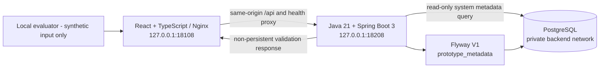

# Architecture

The frontend bridge uses the explicit local test subnet `198.18.108.0/28`. Docker's shared
default address pools were exhausted during startup. Existing Docker subnets and host
routes were inspected read-only before choosing this non-overlapping subnet from the
reserved benchmarking range. This does not change the Docker daemon, host routes, or any
other project's networks. The already-created backend and tooling networks remain
unchanged. If this subnet conflicts on another host, stop and select an approved unused
local test range; do not prune shared networks.

## Implemented increment



The web service and API share a frontend network. The database is connected only to an
internal backend network; the API is connected to both. The API port is exposed on
loopback for local diagnostics. Browser code contains no database address or credentials.

## Repository layout

```text
apps/web/                  React dashboard, unit tests, Vite configuration
services/api/              Spring Boot API, Flyway migration, Java tests
services/worker/           Reserved for a justified later asynchronous worker
packages/contracts/       OpenAPI contract for implemented Phase 1 routes only
infra/docker/             Compose and runtime images / Nginx configuration
tests/e2e/                Browser and HTTP smoke tests
benchmarks/               Reserved; no benchmark numbers invented
docs/                     Requirements, safety, decisions, plan, verification
scripts/                  Project-scoped initialization and local commands
```

## Phase 1 interfaces

| Method | Path                         | Behavior                                                         |
| ------ | ---------------------------- | ---------------------------------------------------------------- |
| GET    | `/actuator/health/liveness`  | Process liveness, independent of DB                              |
| GET    | `/actuator/health/readiness` | Ready only when application and DB are available                 |
| GET    | `/api/v1/system`             | Read the bootstrap schema label from the real DB                 |
| POST   | `/api/v1/sandbox/validate`   | Validate a synthetic reference; never persist or create a worker |

The [OpenAPI document](../packages/contracts/openapi.yaml) is the source of the
implemented payload shapes. Errors use RFC 9457 Problem Details. Public errors must not
contain exception stacks, SQL, credentials, or the raw input body.

The diagnostic request accepts only:

```json
{
  "reference": "synthetic-demo",
  "synthetic": true
}
```

The `synthetic-` reference prefix and confirmation are guardrails, not a guarantee that
arbitrary user-supplied input cannot contain personal data. The form must never be used
with real information.

## Persistence and migration

Flyway creates `prototype_metadata` with one row describing this scaffold. There are no
domain tables or domain writes. Startup fails if migration or database authentication
fails. Schema changes are versioned; existing applied migrations are not edited. The V1
migration has no automatic down migration because dropping a table is destructive;
rollback requires an explicit, reviewed future migration or a separately approved disposal
of local data.

## Configuration and resource boundaries

- Local database credentials are generated once into ignored `.local/secrets/` files and
  mounted as Compose secrets. No credentials are bundled into images.
- PostgreSQL credentials are read through `POSTGRES_PASSWORD_FILE`; the API reads its
  password through Spring's config-tree support.
- Only Actuator health is exposed. Health details are hidden.
- Structured application logs omit request bodies and credentials.
- Runtime services use non-root users, dropped capabilities, `no-new-privileges`, and
  read-only root filesystems with explicit writable paths. Tool containers have bounded
  CPU, memory, and process counts.
- Build/test commands run sequentially to reduce shared-host peak demand.
- No Docker socket is mounted into any project container.

## Intentional deferrals

Redis and Kafka are not useful to this non-mutating synchronous slice and are not started.
Workers, outbox/event delivery, permission enforcement, encrypted storage, malware
scanning, OCR, and human review require their own design and tests in the later phases.
OpenTelemetry instrumentation/export, retries, dead-letter handling, rate limiting, and
production deployment are also deferred.
